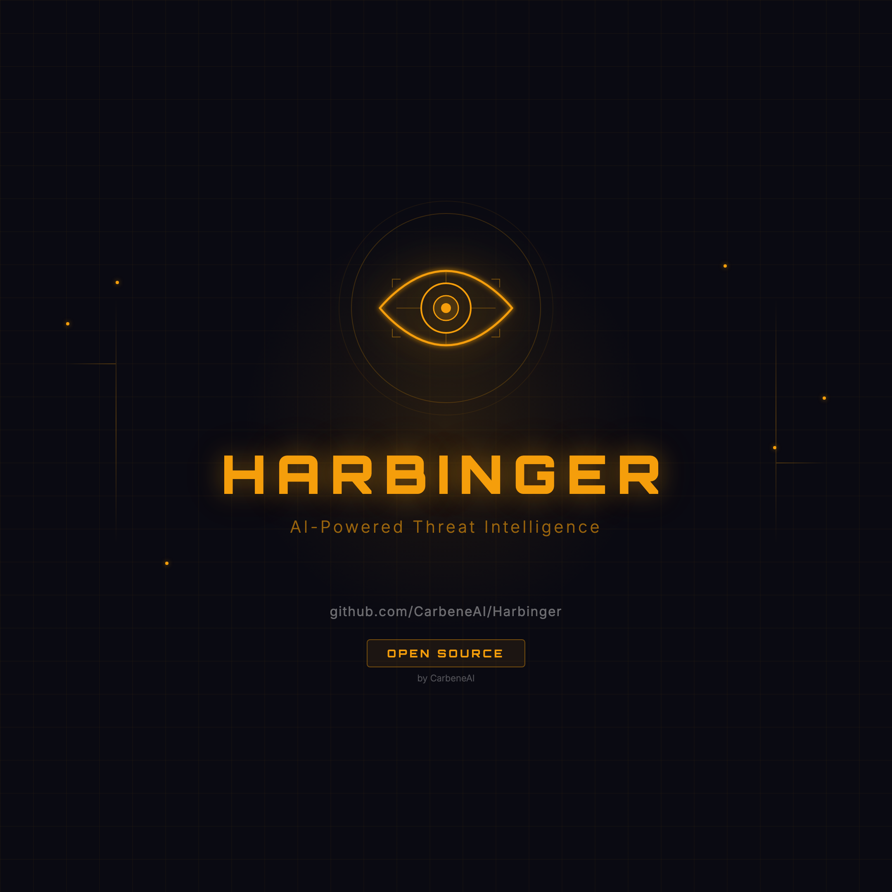
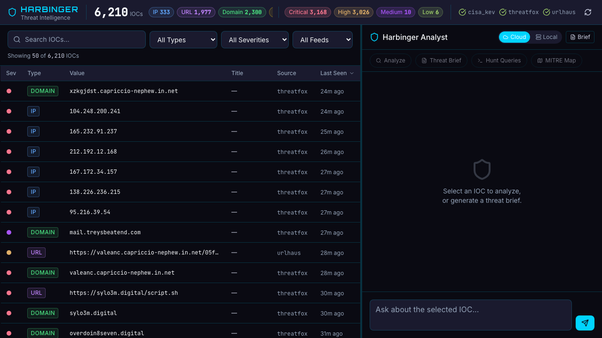
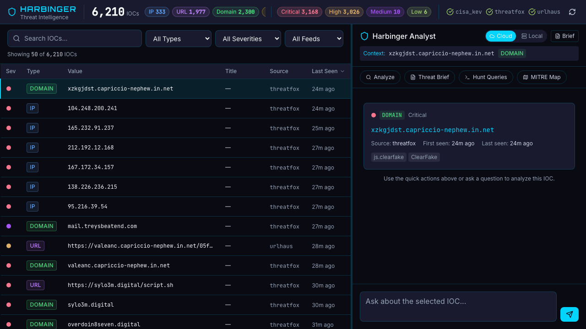
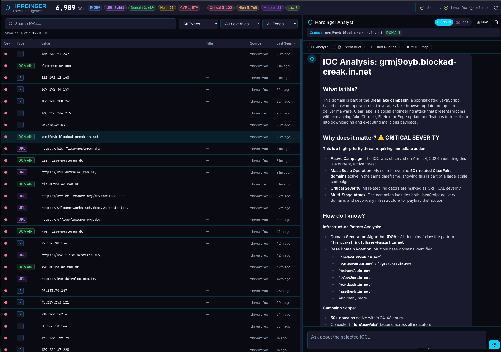
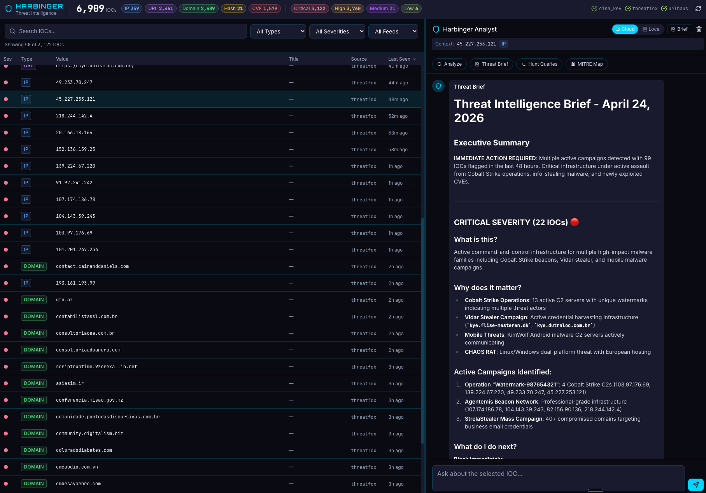

<p align="center">
  
</p>

# Harbinger

**AI-Powered Threat Intelligence Platform**

[](LICENSE)
[](https://bun.sh)
[](https://vuejs.org)

Harbinger is an open-source threat intelligence platform that ingests public IOC feeds, stores them locally in SQLite, and surfaces them through an AI-powered analyst interface. Ask questions about threats in plain English. Choose your analysis backend according to where you want prompt data processed.

## About CarbeneAI

Harbinger is one of four open-source AI security proofs of concept published by CarbeneAI, alongside [Specter](https://github.com/CarbeneAI/Specter) (AI-assisted SIEM), [Talon](https://github.com/CarbeneAI/Talon) (AI-assisted offensive workflows), and [Forge](https://github.com/CarbeneAI/Forge) (AI operations platform). They are not the product. They exist so prospects can see CarbeneAI's founder, Clint P. Garrison, understands the end-to-end strategy of AI in security operations.

CarbeneAI is a Fractional CTO + CISO + AI Strategy advisory practice for CEOs and Boards in risk-driven environments. Clint owns the strategy and risk seat at the client table; CarbeneAI's team and partner network deliver execution.

Use this repo. Fork it. Improve it. For CarbeneAI advisory engagement: [carbene.ai](https://carbene.ai)

## Features

- **Three Threat Feeds** - CISA Known Exploited Vulnerabilities, Abuse.ch URLhaus, and Abuse.ch ThreatFox. URLhaus and ThreatFox require an Auth-Key.
- **AI Threat Analyst** - Ask questions about IOCs in plain English. Harbinger supplies context according to the selected backend: server-side prefetch for Claude CLI, local database tool calls for Anthropic, or selected IOC context for Ollama.
- **CVE Context for Claude CLI** - Harbinger fetches CISA KEV and FIRST.org EPSS data before analysis. Optional Wazuh vulnerability inventory adds affected hosts and packages. The server gathers this context deterministically; a failed Wazuh lookup remains unknown rather than being reported as a confirmed absence. See [CVE enrichment](#cve-enrichment).
- **Auto-Defanged Output** — All AI responses (chat, analyses, threat briefs) automatically defang URLs, hostnames, and IPs using the standard IOC-sharing convention (`http://` → `hxxp://`, `evil.com` → `evil[.]com`, `1.2.3.4` → `1[.]2[.]3[.]4`). Paste briefs into Microsoft Teams, Slack, or email without getting blocked as malicious links. URL paths and CVE IDs are preserved.
- **Cloud/Local AI Toggle** - Local selects your configured Ollama endpoint. Cloud follows the server's `ANALYSIS_PROVIDER` setting, which defaults to Claude CLI over SSH. Review [backend data flows](#cloud-vs-local-ai) before sending sensitive indicators.
- **Analyst Guidance Mode** — AI responses follow a structured triage format: What is this? Why does it matter? How do I know? What do I do next? What should I watch for?
- **IOC Detail Cards** — Click any IOC to see full context: severity, type, description, source, timestamps, tags, and reference links.
- **Threat Brief Generation** — One-click AI-generated threat briefs summarizing the most critical recent intelligence.
- **Hunt Query Generation** — Generate Sigma rules, KQL, and SPL queries for any IOC.
- **MITRE ATT&CK + D3FEND Mapping** — Map IOCs to attack techniques and defensive countermeasures.
- **Full-Text Search** — Search across IOC values, titles, descriptions, and tags with SQLite FTS5.
- **Markdown Rendering** — AI responses render with headers, code blocks, lists, and tables via marked.js.
- **Zero-Config Storage** — SQLite database with no external dependencies. No Postgres, no Redis.

## Screenshots

### Dashboard Overview
IOC table with severity color coding, type badges, search, and filters. AI analyst panel on the right.



### IOC Detail Card
Click any IOC to see full context before asking the AI to analyze it.



### AI Analysis
Structured threat analysis with campaign attribution, severity assessment, and infrastructure pattern detection.



### Threat Brief
One-click AI-generated intelligence brief summarizing critical threats, active campaigns, and recommended actions.



## Tech Stack

| Component | Technology |
|-----------|-----------|
| Runtime | Bun |
| Frontend | Vue 3 + Vite + Tailwind CSS |
| Backend | Bun HTTP server |
| Database | SQLite (bun:sqlite) with FTS5 |
| AI | Claude CLI over SSH (default), Anthropic Messages API, or Ollama |
| Theme | CarbeneAI dark (Tokyo Night) |
| Icons | Lucide Vue |

## Requirements

- [Bun](https://bun.sh) (CI uses version 1.3.14)
- [Abuse.ch Auth Key](https://auth.abuse.ch/) for URLhaus and ThreatFox feeds
- One analysis backend: an authenticated Claude CLI installation reachable over SSH (the default), [Ollama](https://ollama.com), or an [Anthropic API key](https://console.anthropic.com) with `ANALYSIS_PROVIDER=anthropic`.
- *Optional:* Wazuh Dashboard access with vulnerability inventory populated, for environment exposure lookup in the Claude CLI path.

## Quick Start

### 1. Clone the repository

```bash
git clone https://github.com/CarbeneAI/Harbinger.git
cd Harbinger
```

### 2. Configure environment

```bash
cp .env.example .env
```

Edit `.env` and set:

```bash
# Required for URLhaus + ThreatFox feeds (https://auth.abuse.ch/)
ABUSE_CH_AUTH_KEY=your-key-here

# Default backend: an authenticated Claude CLI installation on an SSH host
ANALYSIS_PROVIDER=claude
CLAUDE_CLI_SSH_HOST=user@your-host
# Set CLAUDE_CLI_BIN if the remote executable is not /opt/homebrew/bin/claude.
# Alternatively, use ANALYSIS_PROVIDER=ollama and select a model in the UI,
# or ANALYSIS_PROVIDER=anthropic with ANTHROPIC_API_KEY configured.
```

### 3. Install dependencies

```bash
cd apps/server && bun install
cd ../client && bun install
cd ../..
```

### 4. Start Harbinger

```bash
./manage.sh start
```

Open http://localhost:5174

Feeds begin polling immediately. CISA KEV loads known exploited CVEs, URLhaus adds malicious URLs, and ThreatFox adds IOCs with malware attribution. Initial population depends on network availability and feed authentication.

## Configuration

| Variable | Default | Description |
|----------|---------|-------------|
| `ABUSE_CH_AUTH_KEY` | Unset | Abuse.ch API key, required for URLhaus and ThreatFox |
| `ANALYSIS_PROVIDER` | `claude` | Backend for the Cloud toggle: `claude`, `ollama`, or `anthropic` |
| `CLAUDE_CLI_SSH_HOST` | Unset | Required SSH destination for the `claude` backend |
| `CLAUDE_CLI_BIN` | `/opt/homebrew/bin/claude` | Claude CLI executable on the remote host |
| `CLAUDE_CLI_MODEL` | `sonnet` | Remote Claude model alias or full model name |
| `CLAUDE_CLI_CWD` | `/tmp` | Remote working directory for the CLI session |
| `CLAUDE_CLI_TIMEOUT_MS` | `900000` | Claude CLI timeout in milliseconds |
| `ANTHROPIC_API_KEY` | Unset | Required only for `ANALYSIS_PROVIDER=anthropic` |
| `POLL_INTERVAL_MS` | `3600000` | Feed poll interval in ms (default: 1 hour) |
| `DB_PATH` | `./harbinger.db` | SQLite database file path |
| `PORT` | `4001` | Server port |
| `CLIENT_PORT` | `5174` | Client development server port used by `manage.sh` |
| `WAZUH_DASHBOARD_URL` | Unset | Optional Wazuh Dashboard URL for CVE exposure lookup |
| `WAZUH_DASHBOARD_USER` | `admin` | Wazuh Dashboard user |
| `WAZUH_DASHBOARD_PASSWORD` | Unset | Required with the Dashboard URL to enable exposure lookup |

Copy [`.env.example`](.env.example) for the complete configuration template.

## How AI Analysis Works

When you select an IOC and use the chat panel:

1. The selected IOC is shown as a detail card with full context
2. With the default `claude` backend, Harbinger gathers related local IOCs and CVE enrichment before sending the prompt to the remote CLI. The invocation disables Bash, Edit, Write, Read, WebSearch, and WebFetch; Harbinger supplies the context instead of implementing a CLI tool-use loop.
3. With `anthropic`, the model can call `search_iocs` against the local SQLite database in a bounded tool-use loop. This path does not use the Claude CLI prefetch step.
4. With `ollama`, selected IOC context is supplied without tool use or the Claude CLI prefetch step.
5. Quick actions: Analyze, Threat Brief, Hunt Queries, MITRE ATT&CK/D3FEND mapping

### Cloud vs Local AI

The **Local** toggle selects Ollama. The **Cloud** toggle follows `ANALYSIS_PROVIDER`; it does not necessarily select the Anthropic API.

| Backend | Data flow | Local IOC search | CVE prefetch |
|---|---|---|---|
| `claude` (default) | Prompt sent over SSH to Claude CLI, then handled by that CLI session's provider | Gathered server-side before analysis | Wazuh exposure plus KEV/EPSS |
| `anthropic` | Prompt sent to the Anthropic Messages API | `search_iocs` tool calls | Not used |
| `ollama` | Prompt sent to the configured Ollama endpoint | No tool calls | Not used |

Choose an Ollama endpoint on your own network for local inference. Claude CLI requires an authenticated remote session; the direct Anthropic backend uses API credits. No model calls are needed for the offline contributor checks below.

## Threat Intelligence Feeds

| Feed | Data retrieved |
|------|----------------|
| [CISA KEV](https://www.cisa.gov/known-exploited-vulnerabilities-catalog) | Known exploited vulnerability catalog |
| [URLhaus](https://urlhaus.abuse.ch/) | Recent malicious URLs and domains |
| [ThreatFox](https://threatfox.abuse.ch/) | IOCs with malware attribution from a seven-day window |

The application polls all configured feeds on `POLL_INTERVAL_MS` (one hour by default). Counts vary over time. CISA KEV requires no authentication; URLhaus and ThreatFox use the Auth-Key from [auth.abuse.ch](https://auth.abuse.ch/).

## Auto-Defanged Output

Threat intelligence often involves real malicious URLs and IPs. When you paste an AI analysis or threat brief into Microsoft Teams, Slack, or email, those clients flag live malicious links and either block the message or rewrite it. Harbinger automatically defangs all AI output using the industry-standard IOC-sharing convention before returning it.

### What gets defanged

| Pattern | Before | After |
|---|---|---|
| URL scheme | `http://` | `hxxp://` |
| URL scheme | `https://` | `hxxps://` |
| URL scheme | `ftp://` | `fxp://` |
| Hostname dots | `https://evil.example.com/path` | `hxxps://evil[.]example[.]com/path` |
| IPv4 addresses | `192.168.1.1` | `192[.]168[.]1[.]1` |

### What is preserved

- URL paths, query strings, and fragments (`/api/v1/foo?id=1#bar` is unchanged)
- CVE IDs (`CVE-2021-44228` is unchanged)
- File extensions inside paths (`.html`, `.exe` inside the path stay literal)
- Plain prose with no URLs/IPs

### Where it applies

Defanging is applied to all three AI-output paths:

1. **Chat responses** (Claude CLI, Anthropic, and Ollama)
2. **Threat briefs** (the one-click brief generator)
3. **All quick actions** (Analyze, Threat Brief, Hunt Queries, MITRE ATT&CK/D3FEND)

Two layers of defense: (1) the system prompt instructs the AI to emit defanged form natively, and (2) a deterministic post-processor runs over the response before returning. The post-processor is idempotent — pre-defanged input passes through unchanged.

If you need raw (non-defanged) URLs for a specific use case (e.g. piping into automated scanning), open an issue — we'll add an opt-out flag.

## CVE Enrichment

The default Claude CLI path calls [`buildPrefetchedContext`](apps/server/src/prefetch.ts) before analysis. It gathers related local IOCs and enriches up to five unique CVE IDs with:

- **Environment exposure:** optional read-only searches of `wazuh-states-vulnerabilities*` through the Wazuh Dashboard proxy. Set both `WAZUH_DASHBOARD_URL` and `WAZUH_DASHBOARD_PASSWORD`; the user defaults to `admin`.
- **Known exploitation:** the CISA KEV catalog, cached for six hours.
- **Exploitation probability:** FIRST.org EPSS scores queried by CVE ID.

An unconfigured Wazuh connection is reported as **not checked**. A failed lookup is **unknown**, with a lookup-failed warning; it must not become a claim that the CVE is absent. A successful zero-result query means no affected package was found in Wazuh's monitored inventory, not proof about unmonitored systems.

HTTP 200 alone is not evidence of a complete search. Harbinger checks search completion, shard success, exact CVE hit counts, result structure, and required aggregations before using inventory results. Timeouts, partial shard results, malformed responses, and lower-bound CVE counts remain unknown. CVE lookups request exact totals with `track_total_hits: true`; at most 12 instance samples are returned. Legacy integer totals are also accepted. Health and brief-summary responses validate their own required aggregates instead of treating missing values as zero.

The `anthropic` and `ollama` chat paths do not run this prefetch step. The former `cve-mcp` integration and its `CVE_MCP_*` settings have been removed. Harbinger no longer exposes its former IP, domain, URL, or hash enrichment tools.

### Data flow and operational limits

Harbinger downloads the public KEV catalog and sends CVE IDs to FIRST.org. Wazuh host/package data is gathered from your configured Dashboard and can be included in the prompt sent to the selected analysis backend. These are separate data flows: public CVE queries do not make an AI prompt containing inventory data public-safe.

`GET /enrichment/status` checks Wazuh configuration/connectivity and KEV catalog availability. It can contact live services; it is not an offline readiness test. KEV can fall back to cached data on fetch failure, so consult logs and source freshness before relying on a negative result. CI does not validate live Wazuh, feed availability, SSH, or model responses.

## API Reference

| Method | Endpoint | Description |
|--------|----------|-------------|
| GET | `/health` | Health check with IOC count |
| GET | `/stats` | IOC counts by type, severity, feed |
| GET | `/feeds` | Feed status and last poll times |
| POST | `/feeds/poll` | Trigger immediate feed poll |
| GET | `/iocs?search=&type=&severity=&feed=&limit=&offset=` | Query IOCs with filters |
| GET | `/iocs/:id` | Get single IOC by ID |
| POST | `/iocs/search` | Full-text search IOCs |
| POST | `/chat` | AI chat message with IOC context |
| GET | `/chat/prompts` | Quick prompt templates |
| POST | `/briefs/generate` | Generate AI threat brief |
| GET | `/briefs` | List generated briefs |
| GET | `/settings/ollama-models` | List available Ollama models |
| GET | `/enrichment/status` | Wazuh and KEV connectivity status; may contact live services |

## Manage Script

```bash
./manage.sh start    # Start server + client
./manage.sh stop     # Stop all processes
./manage.sh restart  # Restart
./manage.sh status   # Check if running
./manage.sh logs     # View recent logs
```

## Roadmap

- **Wazuh/Specter Integration** — Bidirectional enrichment between Harbinger and Specter. When Specter sees an alert, Harbinger provides threat context automatically.
- **PDF Report Ingestion** — Ingest threat reports, extract IOCs and TTPs via AI.
- **Custom Feed Support** — Add your own STIX/TAXII or CSV feeds.
- **CVE Inventory Alerting** — Track an inventory of products/versions and alert when new CVEs match.
- **STIX2 Export** — Export IOCs as STIX2 bundles for sharing.

## Part of CarbeneAI's Security Suite

| Tool | Purpose | Link |
|------|---------|------|
| **Talon** | AI-Assisted Penetration Testing | [GitHub](https://github.com/CarbeneAI/Talon) |
| **Specter** | Real-Time SIEM Dashboard | [GitHub](https://github.com/CarbeneAI/Specter) |
| **Harbinger** | AI-Powered Threat Intelligence | You are here |

## Contributing

Pull requests welcome. Please open an issue first to discuss major changes.

The [proposed contributor roadmap](ROADMAP.md) describes reliability priorities and acceptance criteria for maintainer discussion alongside the product roadmap above.

### Offline checks for contributors and coding agents

Run these from the repository root with Bun 1.3.14 to match [CI](.github/workflows/ci.yml):

```bash
(cd apps/server && bun install --frozen-lockfile)
(cd apps/client && bun install --frozen-lockfile)
(cd apps/server && bunx --no-install tsc --noEmit)
(cd apps/server && DB_PATH=:memory: bun test)
(cd apps/client && bun run build)
```

Dependency installation needs package-registry access. The tests and build do not require a configured `.env`, Wazuh, SSH, feed credentials, or model API calls. Context-builder regressions mock data sources and reject unexpected `fetch` calls. Wazuh client fixtures replace only HTTP transport, exercising real response validation, lookup, health, summary, and formatting paths.

Keep exposure states distinct when editing [`prefetch.ts`](apps/server/src/prefetch.ts): not configured, failed lookup, confirmed absent, and confirmed present. Add tests through production functions instead of copying their implementation into the test. Update this README and [`.env.example`](.env.example) when changing provider routing or configuration.

CI validates server tests/typechecking and the client build. It does not deploy Harbinger or establish that live integrations work.

## License

MIT — see [LICENSE](LICENSE)

---

Built by [CarbeneAI](https://carbene.ai)
